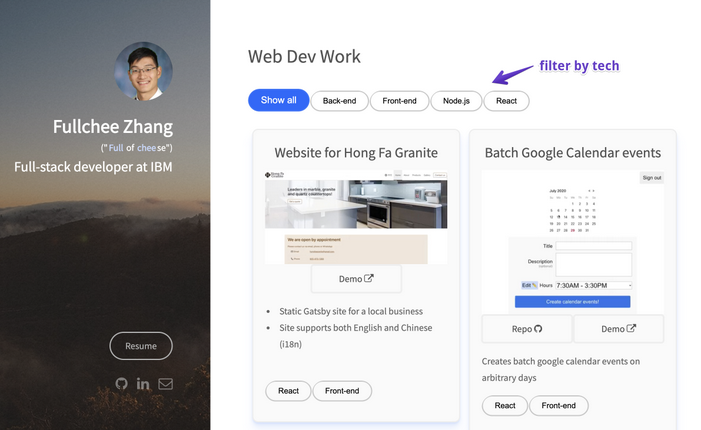

# portfolio

Made with

- Next.js (App Router)
- Tailwind CSS 4
- TypeScript
- MDX
- Storybook

Inspired by

- Josh Comeau's [Building an Effective Dev Portfolio](https://www.joshwcomeau.com/effective-portfolio/)
- juliacodes.com

## Setup

Requires Node 26 and pnpm 12. Versions live in `devEngines` in `package.json`.

1. `./setup.sh` installs pnpm, installs dependencies and sets up the git hooks.
2. `pnpm dev` starts the site at http://localhost:3000.

## Scripts

| Command                          | What it does                       |
| -------------------------------- | ---------------------------------- |
| `pnpm dev`                       | Start the dev server               |
| `pnpm build` / `pnpm start`      | Production build / serve it        |
| `pnpm lint`                      | Run oxlint                         |
| `pnpm format`                    | Run oxfmt                          |
| `pnpm typecheck`                 | Run `tsc --noEmit`                 |
| `pnpm storybook` (or `pnpm sb`)  | Storybook at http://localhost:6006 |

## Git hooks

Lefthook runs on commit: oxlint and oxfmt, type check, a fallow audit and commitlint.
Commit messages follow [Conventional Commits](https://www.conventionalcommits.org/).

## Routing

Routes live under `app/` (Next.js App Router) with server components by default. The shared layout is `app/layout.tsx`.

- `/` home
- `/project` and `/project/<name>` project case studies
- `/uses` (MDX)
- `/attributions`

## Deploy

The site is hosted on Vercel (`vercel.json`). Push to `main` to deploy (automatic).
GitHub Actions (`.github/workflows/ci.yml`) builds every push to `main` and every PR.

## Issues

Tracked in [GitHub Issues](https://github.com/Fullchee/portfolio/issues).

## Previous Portfolios

### [2020 Portfolio](https://github.com/Fullchee/2020-portfolio)

- Gatsby
- filter by tech
- 

### [2019 Portfolio](https://github.com/Fullchee/2019-portfolio)

- Vanilla HTML, CSS
- [Based on this template](https://ryanfitzgerald.github.io/devportfolio/)

## Dependencies

- next
  - [the react docs](https://react.dev/learn/start-a-new-react-project) recommend a framework and Next can do all the things (but I just need a static site)
- @next/mdx
  - write pages like `/uses` in MDX
- @vercel/analytics, @vercel/speed-insights
  - traffic and performance metrics on Vercel

### Dev dependencies

- sharp
  - convert large images to smaller web friendly images of varying dimensions
  - Cloudinary images are still allowed in `next.config.mjs`
  - [Used for production builds](https://nextjs.org/docs/messages/sharp-missing-in-production)
- oxlint, oxfmt
  - lint and format
- lefthook, commitlint
  - git hooks and commit message checks
- storybook, vitest, playwright
  - component stories and browser tests
